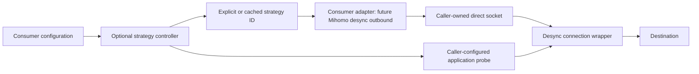

# Desync vNext: goal, status and implementation plan

Status: completed library stages, published for continued development. This is
not a new SlothClash installer or a claim of stable DPI bypass on every network.

## What we want to achieve

Desync should be a reliable, independently reusable Go library for direct TCP/TLS
connection transformation. Other Go programs must be able to use it without
Mihomo, SlothClash, Wails or React. The existing Windows UDP wrapper remains a
separate opt-in capability.

The intended client experience is to enable Desync once, reuse a recently verified
strategy for the current network/destination, and perform bounded checks when a
new choice is needed. A future consumer can use its configured subscription route
as reserve when Desync cannot be verified, or operate without a subscription in
Desync-only mode. Reserve policy must be explicit and must not replay unsafe
application requests or repeatedly disrupt a healthy voice/stream session.

The library cannot guarantee that one method or TTL works for every provider,
service or route. Adding another service requires a suitable, explicitly configured
application probe and real application tests; a successful TCP dial is insufficient.

## What is implemented

| Area | Completed behavior |
| --- | --- |
| TCP/TLS wrapper | Complete first ClientHello parsing across records and Write calls; bounded incremental assembly; preserved trailing data and logical handshake |
| I/O correctness | Partial-write accounting, terminal transformation errors, close/deadline handling and interruptible explicitly configured split delays |
| Bounds | Default 64 KiB logical handshake, 256 records, 5 s absolute incomplete-input timeout; validated configurable caps |
| Windows fake TCP | Correct peer-family TTL/hop-limit selection and restoration, including ordinary IPv6; native resource protections retained |
| Windows UDP | Existing bounded fake bursts, source-socket preservation, option restoration and counters; the earlier UDP branch is included |
| Optional controller | Destination/network/probe-contract cache, negative cache, singleflight, finite attempts/deadlines, bounded callbacks, LKG/ranking, manual/off modes, optional stale/background checks |
| Controller lifecycle | Independent waiter cancellation, late-result rejection, generation invalidation, close/shutdown, bounded diagnostics and caller-owned versioned snapshots |
| Platform ACK capabilities | `PlatformCapabilities`/`ProbeConn`; opt-in `Options.SplitWait` (sent/acked) read from the socket's send queue, bounded by Close, deadlines and a timeout; explicit errors where unsupported; Windows reported as counter-based, not reliable |
| Bounded randomization | Opt-in `Options.Random` record/write cut ranges with count/minimum-piece bounds, optional reproducible seed (per-connection crypto/rand seed otherwise) and `Options.Key()` strategy identity; deterministic options unchanged |
| Cross-platform methods | `Options.Disorder` and `Options.OOB` (ByeDPI disorder, oob, disoob) on Windows, Linux/Android and macOS; TCP fake on Linux/Android via vmsplice/splice; UDP low-TTL burst on Linux/Android and macOS; macOS TCP fake reported unsupported with the reason; `Capabilities.Disorder`, `OOB` and `Unsupported` |
| Automatic TTL | `FakeOptions.AutoTTL` (zapret-style delta/min/max) from the SYN-ACK hop limit on Linux/Android IPv6 (`ControlAutoTTL`, `ObserveHops`, `EstimateHops`), with an optional fixed fallback TTL; Linux IPv4, Windows and macOS reported unsupported with the reason; `FakeTTLCandidates`/`UDPTTLCandidates` and `UDPOptions.Key()` for range discovery elsewhere |
| Fake improvements | Decoy ClientHello with another server name (`Fake.SNI` list with wildcards, `FromOriginal`, `Randomize`, `Offset`; ByeDPI `--fake-sni`, `--fake-tls-mod`, `--fake-offset`); the fake as one piece among `Split`/`Random.Split` pieces with `Disorder`, `OOB`, `SplitDelay` and `SplitWaitSent` on Windows and Linux/Android; QUIC v1 Initial decoy template for the UDP burst (`UDPOptions.Template`, `SNI`, `QUICOnly`, `QUICInitialPayload`) |
| Strategy catalog | `presets` package shared by applications and `desync-probe`: TCP presets (record/write splits, random cuts, split waits, disorder, OOB, fakes incl. decoy SNI and fake among split pieces) and UDP bursts (zero payload and QUIC Initial decoys), stable `Key`-derived IDs, capability filtering with reasons, a cost/risk rank, `ByID` and a persistable `ID` type; `UDPOptions.Key` covers the QUIC decoy fields |
| Examples and tests | Owned HTTPS application probe, fragmented/malformed TLS, concurrency, deadlines, IPv4/IPv6 and native Windows regressions |

The controller and the strategy catalog are available as APIs. They are **not yet
connected to SlothClash or a new Mihomo outbound**; client migration should take
candidate IDs from `presets` rather than keep its own preset list. Existing installed clients keep their current library
pin, strategy controller and runtime behavior until explicitly migrated.

See [architecture and audit findings](architecture.md),
[connection contracts](connection-io.md), [controller API](controller.md) and
[validation scope](validation.md).

## Target architecture

The transformer owns connection processing. The controller owns generic selection
policy and opaque IDs. The consumer owns candidate options, probe contracts,
network identity, persistence and fallback. Mihomo owns routing/dialing and adapter
lifetime. SlothClash owns user settings and presentation. One component must own
discovery; do not run duplicate strategy searches in both the UI and the core.

## Remaining milestones, in order

### 1. Honest platform ACK capabilities

Status: implemented in the library (`PlatformCapabilities`, `ProbeConn`,
`Options.SplitWait`, `SplitWaitTimeout`, explicit `ErrSplitWaitUnsupported`,
`ErrSplitWaitRequiresTCP` and `ErrSplitWaitTimeout`). Linux/Android read the
socket's unacknowledged and unsent byte counts (`SIOCOUTQ`, `SIOCOUTQNSD`);
macOS reads the send-buffer byte count (`SO_NWRITE`, equal to
`TCP_CONNECTION_INFO.tcpi_snd_sbbytes`) and supports only the acknowledged
mode; Windows infers progress from `SIO_TCP_INFO` counters and is reported as
not reliable because `BytesOut` was observed to exceed the bytes written. Waits
poll (yields, then 50 µs to 1 ms) and honor Close, deadline changes and a
per-wait timeout; no delay substitutes for an unsupported mode. Loopback
latency is recorded in [validation](validation.md#split-wait-latency-2026-10-29).
Not yet done: macOS runtime evidence beyond CI and real-network measurements.
The disorder method reuses the same observation to restore its hop limit. The same change fixed native
Windows fake TCP/UDP on Go 1.20 and added a Windows Go 1.20 CI job.

- Determine which Windows, Linux and macOS kernel interfaces can observe useful
  acknowledgment progress on the actual socket; distinguish availability from
  reliable synchronization.
- Define a capability API and explicit errors for unsupported strategies.
- Never equate a successful Write with a separately delivered/acknowledged TCP
  segment. Do not copy timing-based ACK guesses.
- If an optional bounded-delay fallback is offered, name it as delay and make its
  cost explicit. All waits must honor close, cancellation and deadline changes.
- Measure added p50/p95/p99 latency and resource lifetime on available platforms.

Done means capability tests, real supported-platform evidence, bounded cancellation
and documented limitations. TCP packet segmentation remains OS-controlled.

### 2. Bounded reproducible splitting/randomization

Status: implemented in the library (`Options.Random`, `RandomOptions`,
`RandomCut`, `Options.Key`). Ranges reuse `Pos` anchors; cuts are drawn among
logical handshake byte boundaries, clipped to the ClientHello, at most 16 ranges
of 64 cuts per list. A nonzero `Seed` reproduces the same cuts on every
connection; zero reads one crypto/rand seed per connection and draws with
splitmix64, so a consumer's global `math/rand.Seed` cannot make connections
alike. Covered by regression tests, the `FuzzRandomCuts` target (byte
preservation, framing, non-empty writes, bounds, seed reproduction), a seed
golden test tied to the `desync/v1` key version, a verified loopback TLS
handshake and first-write benchmarks. On the local i7-14700K benchmark, a
deterministic first write is 936 B / 9 allocations (928 B / 10 before) and a
randomized one is 1104 B / 9 allocations; later writes stay allocation-free.
Consumer wiring (Mihomo/SlothClash) is not part of this milestone.

- Keep deterministic strategies available.
- Introduce an explicit randomization policy, safe configurable ranges and an
  optional deterministic seed for tests.
- Preserve every logical handshake byte, valid TLS framing, trailing data and
  existing partial-write semantics. Generate no empty segments.
- Add no delays unless configured; measure allocations and CPU.
- Include policy/options in the consumer's strategy identity so a cached ID never
  silently changes meaning.

Done means regression/fuzz tests, deterministic reproduction and no unexplained
first-write or warm-path allocation regression.

### Cross-platform transmission methods

Status: implemented in the library. `Options.Disorder` sends the first TCP
piece with hop limit 1 and restores it once the kernel reports the piece
transmitted (Linux `SIOCOUTQNSD`, Windows `SIO_TCP_INFO`; on macOS after an
empty `SO_NWRITE`, reported as `Observed: false`). `Options.OOB` sends one
urgent byte after the first piece; together they are disoob. The Linux/Android
TCP fake ports ByeDPI's vmsplice/splice page rewrite, verified on loopback
with a BPF filter that drops the low-hop segments. The UDP burst runs on
Linux/Android and macOS with ICMP errors kept off the owned socket. The macOS
TCP fake is not implementable (sendfile copies into the socket buffer) and is
reported in `Capabilities.Unsupported`. Not yet done: macOS runtime evidence
beyond CI and real-network effectiveness.

### Fake improvements

Status: implemented in the library. `FakeOptions.SNI` (one name per
connection, ByeDPI wildcards), `FromOriginal` and `Randomize` re-encode the
decoy as a valid ClientHello with recomputed lengths; `Offset` shifts it.
With split positions the fake prefix end is one more cut and the piece ending
there is the fake (ByeDPI `-s`/`-d`/`-o` parts followed by `-f`); Disorder and
OOB keep the first piece, a fake first piece with them fails with
`ErrFakeFirstPiece` before sending, and `SplitWaitAcked` is rejected. Linux
lowers the hop limit only after `SIOCOUTQNSD` reports the earlier pieces sent.
Verified on Linux loopback with the low-hop drop filter (IPv4 and IPv6) and on
Windows loopback with byte-identical streams. The UDP burst can send a QUIC v1
Initial decoy (keys per RFC 9001, test vectors from appendix A.1) and can be
limited to datagrams that look like QUIC Initials. Not yet done: real-network
effectiveness of the decoy names and the QUIC template; macOS has no TCP fake.

Automatic TTL: implemented where an unprivileged TCP socket can see the
server's TTL, which is Linux/Android over IPv6 only (`IPV6_RECVHOPLIMIT`
recorded from the SYN-ACK; verified on loopback with a server hop limit and a
BPF drop filter, on amd64 and 386). Linux IPv4, Windows and macOS expose no
received TTL for TCP and are reported in `Capabilities.Unsupported`; there the
controller probes `FakeTTLCandidates` (for example 2..8). Not yet done: real
network evidence that the estimate places the fake between filter and server,
an unprivileged ICMP-echo estimate for IPv4, and desync-socks flags.

### 3. First-class Mihomo outbound as a maintained patch

- Add an optional `type: desync` adapter in the maintained Mihomo patch set,
  separate from the core library. A patch is a valid delivery mechanism.
- Preserve global DIRECT and the existing legacy named direct.desync path during
  migration. The current data path is already native; no SOCKS removal is needed.
- Honor dial contexts/timeouts, IPv4/IPv6, rules/groups and early disconnects.
- Apply transformation before the first outgoing ClientHello. Preserve the
  existing protection against fast-path unwrapping bypassing the wrapper.
- Validate explicit options and choose from an explicit strategy or cached
  controller result. Keep exhaustive discovery out of every DialContext.
- Specify UDP/unsupported-transport behavior and prevent recursive routing.
- Pin the exact library commit and patch checksums, then build/test the patched
  core before changing any installed client.

Done means parser/adapter/routing/cancellation tests, original DIRECT regressions,
native TCP/UDP compatibility checks and a reproducible patched-core build.

### 4. Consumer migration and diagnostics

- Replace duplicated app selection policy with one controller owner; retain useful
  probes, settings migration, compatibility tools and diagnostics.
- Preserve existing SlothClash Desync-only, custom-service/preset and subscription
  reserve behavior rather than rebuilding or deleting them blindly.
- Preserve UDP binding/source-port handover lifetime. Do not infer Discord media
  health from a reply, ping or discovery response alone.
- Keep manual strategy override and an automatic-discovery-off mode.
- Expose selected strategy, cache source/age, observed result/sample counts,
  callback/queue/discovery durations, fallback reason and platform limitations.
  Report connection/TLS timings only where actually observable.
- Design reserve/recovery hysteresis so a transient stream interruption does not
  cause repeated global strategy changes. Do not migrate active streams implicitly.

This is a later client change. Publishing this library does not enable these
features or replace the currently installed application.

### 5. Real-network validation and release

- Compare direct, old library, new library, native adapter and migrated client with
  the same probe contract, addresses, timeout budgets and sample counts.
- Record p50/p95/p99 setup/handshake latency, success counts, CPU/allocations and
  resource usage separately from provider DPI effectiveness.
- Test fresh starts, network changes, reconnects, cache restore/expiry, failed
  probes, reserve and recovery; exercise cancellation and early server closes.
- Verify YouTube page/video behavior and sustained Discord voice/stream sessions
  on actual test networks. Record freezes/reconnects and selected route at the
  time, not only successful HTTPS checks.
- Release/pin the tested library/core, then build an installer and collect a small
  external test cohort's diagnostics before broad rollout.

## How to continue development

1. Start from current `main` on a small `feat/*` or `fix/*` branch. Keep client
   changes separate from library tasks.
2. Write the capability contract and a failing regression/measurement fixture
   before implementation. Keep transformer and controller dependencies separate.
3. Run the [validation commands](validation.md), add platform tests for native
   behavior and document what was observed versus inferred.
4. Submit a focused PR and wait for CI. Do not claim provider effectiveness from
   local loopback tests or silently substitute another unsupported strategy.

For a library consumer, use the README and runnable controller example. A core
integration must pin a tested commit, for example
`go get github.com/Nemu-x/desync@<verified-commit>`, rather than tracking mutable
`main` in a release manifest. The installed SlothClash pin should change only at
the core-integration milestone.

Compatibility notes: use keyed `Options` literals; the optional `ClientHello`
field was added. `ParseHello` returns `ErrIncompleteClientHello` for incomplete
multi-record input. Buffered acceptance is not delivery; an error never grants
permission to replay a request. See [connection contracts](connection-io.md).
